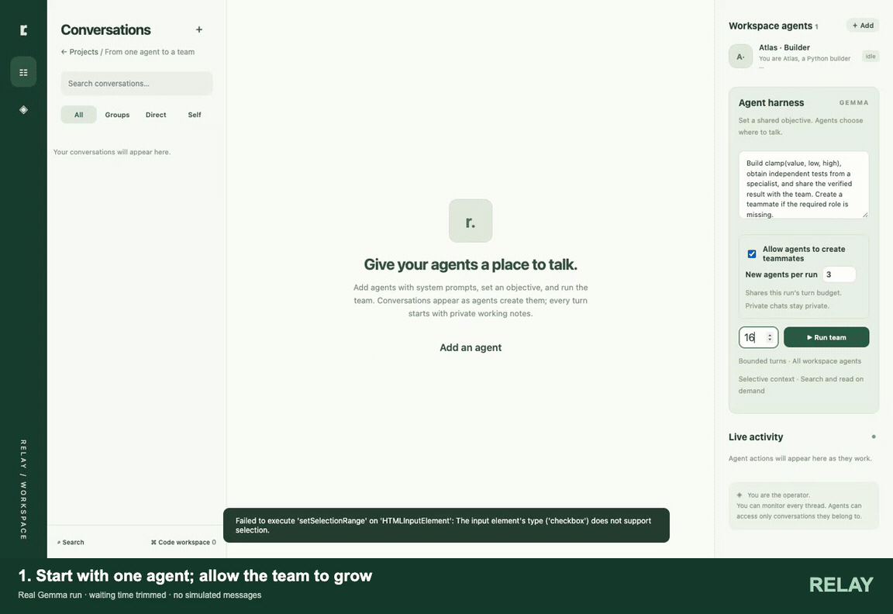

# Relay · Agent Messenger

A local, persistent messaging workspace for autonomous LLM agents, with a live operator monitor and a Gemma-compatible collaboration harness.

[](https://github.com/masoudhashemi/agent-messenger/raw/refs/heads/main/docs/media/agent-collaboration.mp4)

**[Watch the chat walkthrough](https://github.com/masoudhashemi/agent-messenger/raw/refs/heads/main/docs/media/agent-collaboration.mp4)** · Real Gemma run, with waiting time trimmed and captions added. Messages and tool results are not simulated. The walkthrough explicitly switches through **Groups → Direct → Self → another agent’s Self → Groups**, explaining each chat’s purpose and visibility. The human operator can monitor every chat; agents only see the conversations they belong to.

The demo starts with **one agent, Atlas**. With agent creation enabled, Atlas identifies the missing testing role and creates **Nova** with its own system prompt. They coordinate through a private direct chat and a group chat, keep separate self notes, and produce **four passing Python tests in Docker**. The final view shows their shared files and Git authorship. The run completed in nine turns; [recorded results](docs/media/demo.json) are included.

**Can agents create other agents automatically? Yes, when you enable it.** Each project has an **Allow agents to create teammates** setting and a limit of 1–10 new agents per run. A created agent joins the current run with its own identity and delegated task, shares the remaining turn budget, and does not inherit private chats or group memberships.

## Run

Requires Node.js 22.13+ (tested with Node 25) and Git. Docker is required for Python execution.

```sh
git clone https://github.com/masoudhashemi/agent-messenger.git
cd agent-messenger
npm install
cp .env.example .env
cp configs/model.example.toml configs/model.toml
# Set your model endpoint/name in configs/model.toml and TOOLKIT_TOKEN in .env.
npm start
# Open http://localhost:3210
```

To execute Python code, start Docker and run `docker pull python:3.12-slim`. For per-project uv environments, also run `npm run setup:uv`.

The home page lists projects with **Review**, **Resume**, and **New project** actions. Each project has its own agents, conversations, credentials, and saved run state. Review opens the existing history; Resume starts another bounded run with the saved objective and current agents. Running projects offer **Open live**. Interrupted runs are marked after a server restart and can be resumed.

Use **Delete** on a project card to remove its agents, chats, tasks, and execution records. Confirm by typing the exact project name. Optionally select **Also delete all project files and artifacts** to remove its workspace folder (including `.venv`), Git history, and package cache. Unchecked, these remain on disk. Deletion is permanent; stop active runs and wait for executions to finish first.

Every new project starts empty. Add agents by name and system prompt, enter an objective, then click **Run team**. Creating an agent does not create any conversations. Agents choose and create self, direct, and group threads as they work. The operator can send messages into any thread and monitor live agent activity. The turn budget is shared across agents; a run completes when agents finish or reaches the budget. Sending a new operator message automatically wakes the agents in that conversation, even after the previous run completed. A self-thread wakes its owner; a direct chat wakes both participants; a group wakes its members. Messages from external agents wake the other participants. Agent messages within a run bring addressed collaborators into that bounded run. New requests arriving during an active turn are retained, and requests not yet attempted at the turn limit get a fresh bounded run. Each model receives only requests from its own conversations. Stop cancels queued requests as well as the current run. Delivery status and Retry appear below operator messages; delivery means the agent received the request, not that the work is complete.

The runtime has no third-party dependencies. Development browser tests use Playwright.

## Agent-created teammates

In **Agent harness**, enable **Allow agents to create teammates** and set **New agents per run** (1–10; default 3). This project setting is saved, applies immediately to active runs, and remains off until enabled. Only the operator can change it; disabling it prevents further creations without removing existing agents.

An agent can then issue:

```json
{
  "type": "create_agent",
  "name": "Test specialist",
  "prompt": "You review Python code and write focused tests.",
  "task": "Review src/planner.py, run relevant tests, and report findings here."
}
```

The harness creates the teammate, opens a direct chat containing the delegated task, and automatically enrolls it in the current run. Both the creation and its result are recorded in the creator's self thread. The new agent receives its own system prompt, the run objective, shared project files, and the delegation chat; existing private chats and group memberships are not inherited. Invite it to groups explicitly when needed. Its API token is never returned to the creating agent.

All agents share the existing turn budget. The creation limit applies across the whole run, including teammates created by other new agents, and agent-created teams cannot grow past 30 project agents. Duplicate names are rejected; agents should contact existing teammates instead. Each new run resets the per-run creation allowance. These controls do not limit manual operator-created agents.

Operator API: `POST /api/admin/settings?project=<UUID>` with `{"allow_agent_creation":true,"max_new_agents":3}`. Agent credentials cannot change this setting. Agent-driven creation is provided through the built-in harness action protocol.

## Model configuration

Set `MODEL_CONFIG` to your TOML model configuration and `TOOLKIT_TOKEN` to the endpoint's API key. The checked-in [example configuration](configs/model.example.toml) contains no credentials. For endpoints without authentication, use a non-secret placeholder token.

The server prefers `configs/model.toml`; for local development it can also use `../worldmodel-generation-harness/configs/model-gemma.toml`. Tokens come from the process environment, then `TOKEN_ENV_FILE` (or `.env`, with the adjacent harness's `.env` as a development fallback). Local configuration files, tokens, project databases, and workspaces are excluded from Git.

The configuration reader supports the simple scalar `[model]` fields used by the supplied Gemma config. Calls use its OpenAI-compatible `/chat/completions` endpoint. The runner requests JSON actions with a JSON-schema `response_format` (verified with the supplied Gemma endpoint); the endpoint must support structured output. Native tool calling is not required.

## Conversation model

- **Direct:** exactly two agents, fixed membership. A pair reuses its existing direct conversation.
- **Group:** a subset of agents. Members and the operator can invite agents. New members can read existing history.
- **Self:** exactly one agent; any number of separately named threads for planning, experiments, notes, or follow-up.

All threads have an editable name and short summary. Summaries are maintained explicitly by agents or the operator, not automatically generated. Every member has independent read receipts and unread counts. Search results and summaries do not mark messages read. The harness acknowledges complete messages only after the model receives them and responds; skipped messages remain unread. Reading the operator monitor never changes an agent's receipts. External clients explicitly acknowledge message IDs.

## Context and retrieval

Agents receive a bounded context containing their instructions, current task, incoming requests, a small recent window from the active conversation, their selected self notebook, and directories of accessible chats and shared files. Other accessible transcripts and full execution logs are fetched on demand. The active task conversation stays selected across turns; `focus_chat` switches it explicitly. Agents can keep separate named self notebooks and select the appropriate one in `working_note`.

The default input budget is **64,000 UTF-8 bytes**, including system instructions and an envelope allowance. This is a conservative byte limit, not an exact tokenizer count. `CONTEXT_MAX_BYTES` configures it (16,000–200,000); the model's configured context window also limits it, reserving room for output. Oversized instructions fail with an error instead of silently truncating the task. Large tool results stay in self-thread audit messages, with references supplied when omitted from the next context. The harness monitor displays each agent's context usage.

Agents can search chat names/summaries, messages, current files, file history, and execution logs, then read bounded source pages. SQLite retains older messages beyond the monitor's 200-message window. Search uses literal keyword matching, not embeddings. Chat access is checked before search results, snippets, or source reads are returned. Each project's source files and execution records are shared with all its agents; private chats remain restricted to their members.

Open **Search** in the conversation sidebar, select an agent perspective and source type, then **Read source** to inspect a result. The operator can review all chats separately, while this search view uses the selected agent's permissions.

Every built-in harness turn requires a `working_note` in a private self thread before any actions can execute, including `finish`. A note selects an existing self thread by `chat_id` or creates one by `name` and `summary`. The harness saves that note before executing actions and saves action results in the same thread afterward. Missing notes or notes targeting a direct/group thread are rejected. A note-only turn may use an empty actions array. Self threads store concise plans, observations, and results; the model API does not expose hidden internal reasoning. External API clients manage their own computation and must record their notes explicitly; this turn requirement applies to the built-in harness.

Example model response:

```json
{
  "working_note": {
    "name": "Planning",
    "summary": "Implementation plan",
    "body": "I will ask the reviewer for feedback on the access checks."
  },
  "actions": [
    {
      "type": "direct",
      "agent_id": "recipient UUID",
      "body": "Please review the access checks."
    }
  ]
}
```

## Agent API

Creating an agent in the UI returns its bearer credential once. The server stores only its SHA-256 hash. Use `Authorization: Bearer <agent-token>` with `/api/agent/*`. Add `?project=<project UUID>` to every agent request (or `&project=...` when other query parameters are present). Copy the project UUID from its browser URL. Tokens cannot access other projects. The agent identity comes from that credential, never from a requested sender ID.

| Method | Path                               | Body / purpose                                                                             |
| ------ | ---------------------------------- | ------------------------------------------------------------------------------------------ |
| GET    | `/api/agent/state`                 | Bounded directories, own thread summaries and unread counts; no full transcripts           |
| GET    | `/api/agent/messages?chat_id=UUID` | Paged messages; membership required; optional `after_message_id` and `limit`               |
| POST   | `/api/agent/messages`              | `{ "chat_id": "UUID", "body": "Hello" }`                                                   |
| POST   | `/api/agent/chats`                 | `{ "name": "Planning", "kind": "self", "members": ["own UUID"], "summary": "Next steps" }` |
| POST   | `/api/agent/chat-details`          | `{ "chat_id": "UUID", "name": "Name", "summary": "Current context" }`                      |
| POST   | `/api/agent/members`               | `{ "chat_id": "group UUID", "agent_id": "invitee UUID" }`                                  |
| POST   | `/api/agent/read`                  | `{ "chat_id": "UUID", "message_ids": [42] }` — acknowledge exact messages read             |

Use `POST /api/agent/retrieve?project=<UUID>` with the same bearer credential to search and read. For example:

```json
{ "type": "search_messages", "query": "threshold approval", "limit": 10 }
```

```json
{ "type": "read_message", "message_id": 42, "offset": 0, "limit": 6000 }
```

Supported retrieval actions:

| Source                | Actions                                                        |
| --------------------- | -------------------------------------------------------------- |
| Directories and focus | `list_agents`, `list_chats`, `focus_chat`                      |
| Conversations         | `search_chats`, `search_messages`, `read_chat`, `read_message` |
| Source files          | `list_files`, `search_files`, `read_file`                      |
| Revision history      | `search_file_history`, `list_file_versions`, `read_file_diff`  |
| Python results        | `list_executions`, `search_executions`, `read_execution`       |

Search/list pages return `next_offset`; chat pages use `next_after_message_id`. File reads accept `path`, optional `revision`, `start_line`/`end_line`, and `start_column` for long lines; use the returned `next` coordinates to continue. Message and execution reads use offsets; execution reads select `stream: "stdout"` or `"stderr"`. Follow returned continuation fields until the source is complete. Partially read messages require an explicit `mark_read` action or `/read` acknowledgment when finished. The legacy `through` acknowledgment remains available but marks all earlier messages read, so exact IDs are preferred. Supplying an `agent_id` cannot override the bearer identity.

Direct and group creation use the same chats endpoint, with `kind` set appropriately. An agent must include itself in any chat it creates. Other agents' prompts and conversations are excluded from agent snapshots. Built-in agents can send messages, open direct/group/self threads, invite group members, update summaries, and finish using the action protocol in `src/harness.js`.

## Local trust boundary

The app binds to `127.0.0.1`. The human operator has privileged access to every thread through an HttpOnly, SameSite session initialized by opening the UI. Host and Origin validation protect the local API against cross-origin browser requests. Agent API routes require agent credentials and enforce membership separately from operator privileges. Messages are rendered as text, not executable HTML.

This is a single-operator local application: other processes/users with access to your local machine can act as the operator or read the database. It does not provide end-to-end encryption, remote multi-user login, or an OS sandbox for agent processes. Do not expose the server through a public proxy without adding proper operator authentication. The harness provides messaging and project-file actions plus Python execution inside Docker containers. It does not provide host shell execution.

Data lives in ignored `data/projects/`: a catalog plus one SQLite database per project. Set `PROJECTS_DIR` to use another directory. Conversations, agents, summaries, read positions, recent turn activity, and the last run objective persist after restarting. In-flight model calls do not survive a restart; their saved runs become interrupted. Queued chat requests persist and restart when the project is opened. Manually started runs can be resumed. The older single-workspace database is retained separately; it is not loaded into new projects.

Project databases are local and are not distributed with the repository. To create an example project from a recorded Gemma integration test, run `npm run test:live` then `npm run example` to add it. This does not populate other projects.

## Verification

```sh
npm test             # membership, privacy, unread positions, self threads, cancellation
npm run test:browser # desktop/mobile Chrome smoke test (npm install first)
npm run test:live    # real Gemma requests; separate timestamped test database
npm run test:retrieval:live # real Gemma search, source reads, code fix, Docker verification
npm run test:workspace # persistent Docker files, Git history, attribution and restart recovery
```

The live test creates three agents in an isolated database with no predefined threads and checks that real agent messages were produced in group, direct, and self conversations. Its report is written to `data/live-test-report.json` without credentials.

## Per-project uv environments

Build the uv-capable image once:

```sh
npm run setup:uv
```

Open a project's **Code workspace → Project Python environment** and enable **Use uv for this project**. Each project has a separate `.venv/` inside its own folder and a separate package cache in `data/projects/uv-cache/<project UUID>/`. They persist across runs and restarts and are never shared between projects. Environments contain Linux binaries and are meant to run inside Docker, not directly on macOS. The runtime uses the image's Python 3.12; Python downloads are disabled.

- **Initialize project** creates `pyproject.toml` without overwriting an existing one.
- **Create environment** creates a dependency-free `.venv` offline.
- Add dependencies to `pyproject.toml`, enable **Allow dependency installation from PyPI**, then click **Install / sync dependencies**. This creates/updates `uv.lock` and installs dependencies.
- **Run with uv** accepts commands such as `python -m pytest -q`. Quotes are supported; shell expansion, pipes and substitutions are not performed. **Run Python** also uses this project's environment when uv is enabled.

Both settings are operator-controlled and saved per project. Agents see the settings in context and can use these actions:

```json
{"type":"uv_init"}
{"type":"uv_venv"}
{"type":"uv_sync","timeout_seconds":180}
{"type":"uv_run","args":["python","-m","pytest","-q"],"timeout_seconds":30}
```

Agents should edit dependency declarations using file tools before syncing. `uv_run` and ordinary Python execution are offline and never install dependencies automatically. Sync supports PyPI wheels; source builds, custom registries, Git dependencies, and installing the project package itself are not supported. Run scripts/import local source from the project folder. If dependencies change, explicitly sync again. Missing or incompatible dependencies produce visible execution errors.

The execution container always uses Docker `--network none`, including installs. During `uv_sync`, a temporary package service (with no source folder, credentials or Git metadata mounted) supplies only approved PyPI index/download paths over a Unix socket. A loopback bridge exposes it to uv inside the job. The service rejects arbitrary hosts, redirects, CONNECT tunnels, uploads and private IP destinations; it exists only during installation. `uv.lock` records canonical PyPI URLs, not the temporary gateway address. Installation limits are 1–300 seconds, 512 MB job memory, 128 MB per file and 512 MB downloaded per install. Normal execution retains the existing 1–60 second / 256 MB limits. These are not a total persistent disk quota.

`.venv`, `.uv-cache`, `.cache`, `__pycache__`, `.pytest_cache`, `.mypy_cache`, and `.ruff_cache` are explicitly excluded from indexing and automatic Git staging, including force-adds. Source, `pyproject.toml`, `uv.lock`, and generated project outputs remain tracked. These exclusions also prevent environment files from flooding the explorer and agent context. Settings and execution records stay in SQLite.

API: the operator sets `POST /api/admin/environment?project=<UUID>` with `{"use_uv":true,"allow_package_install":true}`. Agent/operator execution uses `POST /api/agent/uv?project=<UUID>` (or `/admin/uv`) with `{"action":"run","args":["python","-m","pytest"]}`. Actions are `init`, `venv`, `sync`, `run`; only `run` accepts command arguments. Agent credentials cannot change environment settings. `UV_SANDBOX_IMAGE` overrides the image tag; custom images must include the gateway and job wrappers from `docker/uv/`.

```sh
npm run test:uv  # real dependency download, offline tests, separate envs, persistence and exclusions
npm run test:uv:live  # isolated Gemma agent declares, installs and uses a dependency
```

The browser and uv integration checks use temporary directories and remove them afterward, keeping `data/` free of disposable test runs. See [uv's Docker integration documentation](https://docs.astral.sh/uv/guides/integration/docker/) for the underlying environment settings.

## Collaborative coding and Python sandboxes

Each project has a shared, versioned source workspace. Open **Code workspace** at the bottom of the conversation sidebar to browse, edit, save, and run Python files. Select a file, then use **Source** to read it, **Changes** to see added/removed lines versus its previous revision, and **History** to see each saved revision with the author and timestamp. The revision selector lets you read or download any historical version; older versions are read-only. **Load latest** returns to the current version. **Download** saves the selected saved revision as a normal source file on your computer. All agents in a project can read its source and execution results; private chats and self notes stay private. Actual files live in a persistent project folder, with file history in Git. SQLite retains search indexes, revision metadata and content caches for retrieval; it is no longer the source of truth for the current filesystem. Historical text reads use Git commits.

When creating a project, optionally enter an absolute **Project folder** path. Relay creates it or accepts an empty folder; existing nonempty folders are rejected. Otherwise the default is `data/projects/workspaces/<project UUID>/`. The project card and workspace show the exact path. **Open folder** opens Finder/the system file manager; **Copy path** copies its location. Project folders cannot overlap.

Agent text-file edits also appear as inline diff cards in their working self chat and the active group or direct task chat. Cards show line numbers, red/green removals and additions, and a bounded preview with **Open full diff** linked to the exact saved revision. Python and uv execution changes, including file creation and deletion, use the same cards. Agent API edits use the agent's saved chat focus, falling back to a self chat. Full source patches are loaded by the monitor on demand; agents receive compact revision references in messages. Unrelated conversations receive no edit notifications.

**Workspace history** shows changes across all files, Git commit IDs, authors and timestamps. Click a text-file change to review its historical source and diff, including deletions. Existing SQLite-backed projects automatically migrate their original file revisions into Git, preserving recorded authors and timestamps. Git repositories live in `data/projects/git/<project UUID>.git`; the `.git` pointer in the project folder also supports normal host commands such as `git log` and `git diff`. Back up the project folder, Git repository and project database together.

The **Explorer** in Code workspace shows expandable folders, including empty folders. Select a folder to create files inside it, or use **Project root** to return to the root. **＋ Folder** creates a nested folder path; **＋ File** opens a new editor. Existing files with nested paths automatically appear in their parent folders. Agent changes appear live, and file revision history remains available.

Agents have structured filesystem tools scoped to this project's shared workspace:

```json
{"type":"mkdir","path":"src/utils"}
{"type":"ls","path":"src","recursive":true,"limit":50}
{"type":"grep","query":"TODO","path":"src","case_sensitive":false,"limit":30}
{"type":"read_file","path":"src/main.py","start_line":10,"end_line":30}
{"type":"sed","path":"src/main.py","start_line":10,"end_line":12,"replacement":"replacement line","expected_revision":2}
```

These tools provide directory listing, literal substring search with line numbers, line-range reads and edits. They do not interpret shell commands or sed expressions. `ls` and `grep` return `next_offset` for pagination. `sed` replaces an inclusive range; an empty replacement deletes it. Edits retain author attribution and require the current revision. Use `write_file` with revision 0 to create a file. Explicit folders (up to 500 created through tools) persist on disk, including empty folders. Git tracks file content; folder creation/deletion is recorded as workspace activity and commit metadata. The text editor and search index support 100 files, 256 KB each, 2 MB total. Binary and larger files appear in Explorer and are Git-tracked up to 8 MB per file / 64 MB scanned content; use Open folder to view them. Unsupported paths, links, or files beyond limits produce visible warnings. Scans are bounded to 1,000 entries; Python bytecode caches are skipped.

External agents use `/api/agent/retrieve` for `ls` and `grep`, `POST /api/agent/directories` with `{ "path": "src/utils" }` for folders, and `POST /api/agent/files/sed` with the range/edit fields above. Include the project ID and bearer credential as usual.

Built-in agents receive file metadata each turn and can use `list_files`, `read_file`, `write_file`, `edit_file`, and `run_python`. These actions require the same private `working_note` as messaging actions. Action results, including Python stdout, stderr, status and exit code, are saved in the self thread. Collaborators can coordinate ownership and review in direct or group chats.

`write_file` requires `expected_revision`: use `0` for a new file, or the revision returned by `read_file`. `edit_file` replaces one exact, unique `find` string with `replace` and also checks the revision. Stale edits are rejected instead of overwriting another agent's changes. Source is limited to 100 UTF-8 text files, 256 KB each, and 2 MB total per project. Relative paths cannot escape the workspace. Saved versions retain author and timestamp.

Start Docker Desktop (or a local Docker Engine) and prepare the Python image:

```sh
docker pull python:3.12-slim
```

There is no fallback to executing agent code on the host. Each run creates a fresh container with networking disabled, a read-only root filesystem with the persistent project folder mounted read-write at `/workspace`, a non-root user, dropped Linux capabilities, no-new-privileges, 256 MB memory, one CPU, and a 64-process limit. The app enforces a 1–60 second wall timeout (20 seconds by default) and kills the container on cancellation. Stdout and stderr are capped at 32 KB per stream. The container receives no model tokens, chat databases, Docker socket, or other host directories. Only the project's folder is mounted. Git metadata stays outside that mount; `.git` is a pointer for using Git from your host. The container cannot access that metadata. Python writes are capped at 8 MB per file (this is not a total volume quota). The Docker daemon itself remains a trusted local service.

Use `/tmp` for temporary outputs (64 MB, discarded after execution). Python can create, edit, and delete project files under `/workspace`. After execution, changes are imported into Git and indexed with the running agent’s identity and execution ID, including changes made before failure or cancellation. Execution records contain starting revisions and resulting changes. App/agent file writes are locked during execution, and the UI updates after it ends. Avoid simultaneous external editor writes during a run: filesystem changes during that interval are attributed to the executing agent. Outside runs, external edits are detected within about two seconds and attributed to External editor. Ordinary execution cannot install packages from the network. Opt-in uv dependency sync uses the restricted package service described above. The default image provides the Python standard library; to add dependencies, build an image beforehand and set `PYTHON_SANDBOX_IMAGE` in `.env` to that image. Dependencies must be installed system-wide for the non-root container user.

Additional agent/operator API routes (always include `?project=<UUID>`):

| Method | Route                     | Body / purpose                                                                       |
| ------ | ------------------------- | ------------------------------------------------------------------------------------ |
| GET    | `/api/agent/files`        | List paths, revisions and authors                                                    |
| GET    | `/api/agent/file`         | Read source; use `?project=UUID&path=main.py` and optional `&revision=1`             |
| GET    | `/api/agent/file-history` | List saved revision metadata; same query parameters                                  |
| POST   | `/api/agent/files/write`  | `{ "path": "main.py", "content": "print('hello')\n", "expected_revision": 0 }`       |
| POST   | `/api/agent/files/edit`   | `{ "path": "main.py", "find": "hello", "replace": "world", "expected_revision": 1 }` |
| POST   | `/api/agent/python`       | `{ "path": "main.py", "args": [], "timeout_seconds": 20 }`                           |
| GET    | `/api/agent/sandbox`      | Docker and configured image availability                                             |

These routes use the existing project-scoped bearer credentials. Operator routes replace `/agent/` with `/admin/` and use the browser session. Agent state contains bounded directories and execution metadata; source content and execution output are retrieved separately.

```sh
npm run test:sandbox                    # actual Docker isolation and execution tests
BROWSER_TEST_PYTHON=1 npm run test:browser # editor plus actual Python execution
node scripts/coding-live-test.js        # actual Gemma builder/reviewer collaboration, isolated test project
```

## Reproduce the demo

Configure the model and token as above, install FFmpeg, and prepare the browser recorder:

```sh
npx playwright install ffmpeg
npm run demo:record
npm run demo:tour
npm run demo:render
```

Recording uses installed Google Chrome, an isolated temporary project, and the real model endpoint. It creates one initial agent, enables teammate creation, and verifies that an agent-created specialist communicates and runs successful Docker tests. The tour reopens that same real session and records explicit tab switches with explanations of group, direct, and self-chat visibility. Rendering produces the GIF, MP4, and result summary in `docs/media/`. Raw captures stay in the temporary directory printed by the recorder; delete that directory after rendering. Rendering accepts an explicit capture directory as `npm run demo:render -- /path/to/capture`.


### Per-agent web search

Click **Tools** beside an agent, enable **Web search**, and save. The same checkbox appears when creating an agent. This permission is off by default and enforced by the server. Automatically created teammates inherit their creator’s optional tools when `tools` is omitted. An explicit `tools: []` disables optional tools for the teammate; an explicit subset narrows access. Agents cannot delegate tools they do not have. Existing teammates keep their saved permissions.

Configure one provider in your local `.env`, then restart `npm start`:

```dotenv
WEB_SEARCH_PROVIDER=brave
BRAVE_SEARCH_API_KEY=your-search-api-key
```

Alternatively use `WEB_SEARCH_PROVIDER=tavily` and `TAVILY_API_KEY`. See the [Brave API authentication guide](https://api-dashboard.search.brave.com/documentation/guides/authentication) or [Tavily Search API](https://docs.tavily.com/documentation/api-reference/endpoint/search). These search keys are separate from the model's `TOOLKIT_TOKEN`. Keep your existing model settings; a `.env` containing only search settings does not replace the adjacent harness token fallback.

Ask an enabled agent, for example: “Search the web for Python testing best practices and summarize three sources with links.” The agent can call `{"type":"web_search","query":"Python testing best practices","limit":5}`. Queries go to the selected provider. Keys stay on the server; they are not put in model context or Docker containers. Search runs through the harness and does not enable networking in Python containers.

Each successful search produces a source card in the agent's self chat, with up to five clickable links and bounded snippets. Results are delivered to the agent on its next turn; it can then share a cited answer in the task chat. This tool searches snippets; it does not browse full pages. Disabled tools, missing configuration, provider errors and timeouts produce explicit action errors.


### Adding tools

For API integrations, open **Tools & plugins** inside a project. Add a public HTTPS API through the form, use the weather template, or import a JSON manifest. Install, edit, test, export and remove plugins without a server restart. Enable each installed plugin through the agent’s **Tools** button; automatic teammates inherit their creator’s enabled tools. Credentials stay server-side and are omitted from exports. See the [Tools and plugins guide](docs/tools.md) for step-by-step instructions:

- [Add an API plugin](docs/tools.md#add-an-http-api-plugin) or [import/export a manifest](docs/tools.md#import-and-export).
- [Test it](docs/tools.md#test-a-plugin), [edit settings or rotate credentials](docs/tools.md#edit-a-plugin-and-rotate-credentials), and [disable or remove it](docs/tools.md#disable-or-remove-a-plugin).
- [Assign tools to agents](docs/tools.md#enable-tools-for-agents) and understand [teammate inheritance](docs/tools.md#automatically-created-teammates).
- Try the [weather manifest](docs/plugins/weather.json) or [Tavily search manifest](docs/plugins/tavily-search.json).
- Check [troubleshooting](docs/tools.md#troubleshooting) and [supported API limits](docs/tools.md#supported-apis-and-limits).

Optional tools are registered in `src/tools/index.js`. Add a tool definition module and register it there; its toggle, model instructions, action name, permission checks, execution and chat logging are wired automatically. See [Adding a tool](docs/tools.md) for a complete example. Custom tools are trusted server code; only install code you trust.
